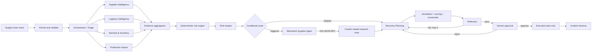

# Architecture

Supplier and logistics agents discover read-only database and date-calculation tools through MCP. AI interprets, investigates, proposes, and explains. Deterministic Python calculates and validates. SQLite stores source records, workflow state, evidence, strategies, decisions, execution plans, outcomes, security events, and evaluation results. Humans alone authorize the final action plan; the MVP never places real orders.

